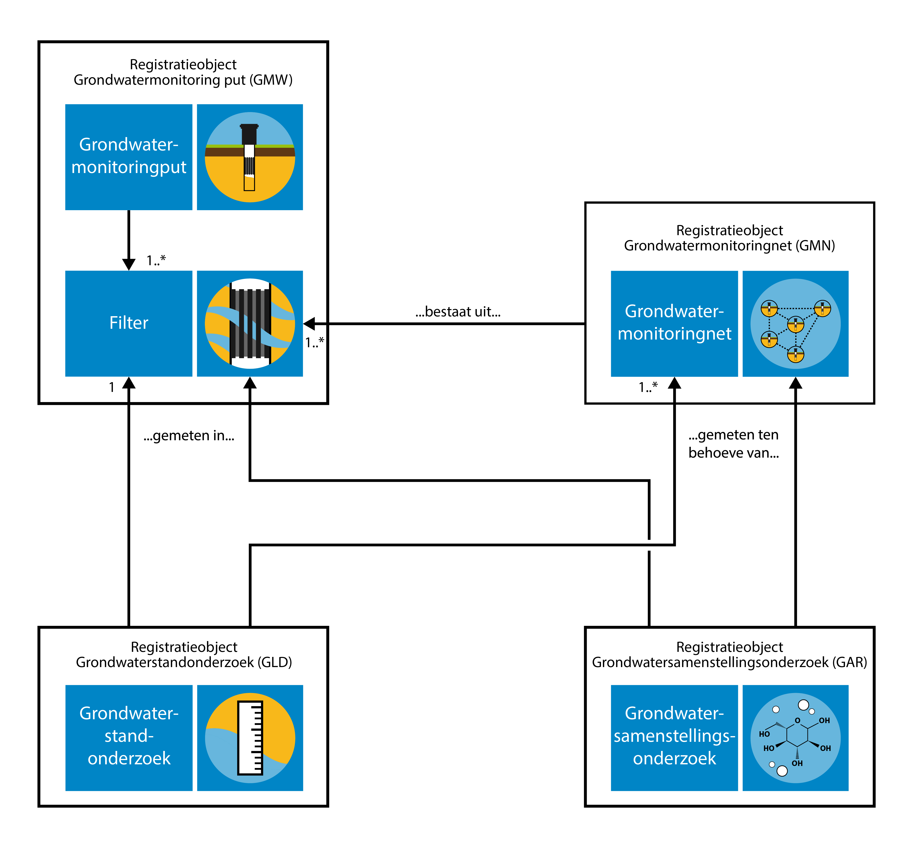
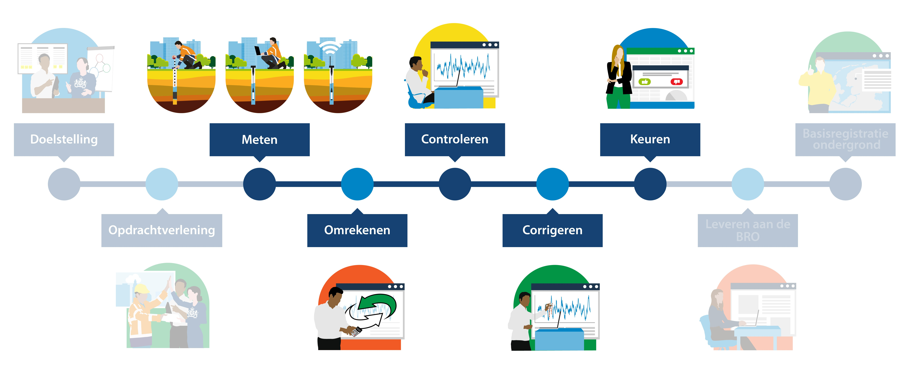
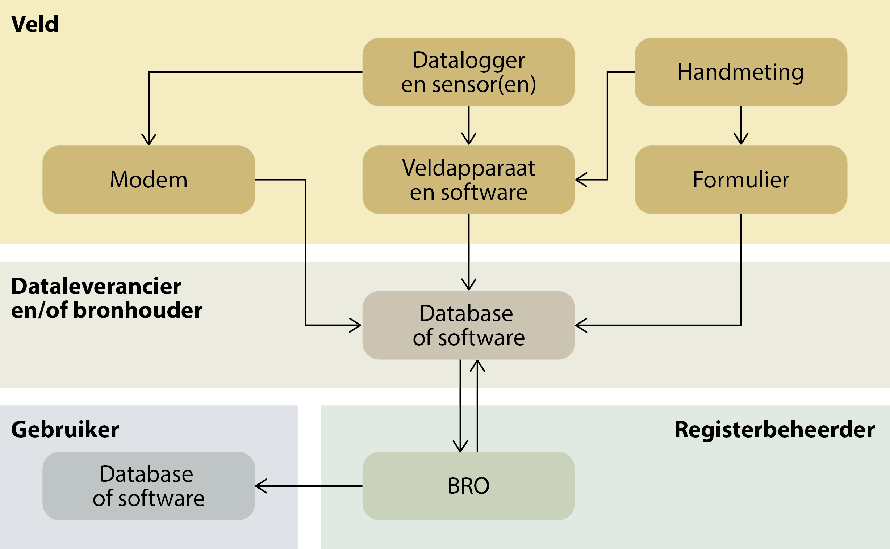
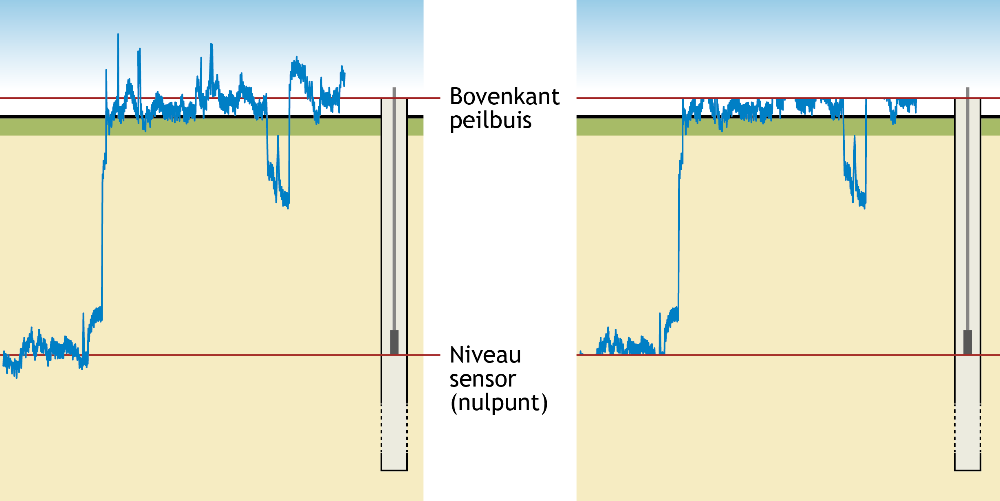

# Grondwaterstandonderzoek
## Grondwatermonitoring
Grondwater is een belangrijke bestaansbron. Het grondwater wordt daarom in Nederland in de gaten gehouden en beheerd. Het beheer van het grondwater richt zich op de hoeveelheid grondwater en de kwaliteit ervan. Om dit beheer goed te kunnen uitvoeren, wordt in Nederland de toestand van het grondwater over langere tijd gevolgd. Dat heet grondwatermonitoring. Er wordt daarbij gekeken naar de grondwaterstand (kwantiteit), en naar de samenstelling van het grondwater (kwaliteit). Hiervoor worden periodiek grondwaterstandonderzoeken en grondwatersamenstellingsonderzoeken uitgevoerd. Door het verzamelen van deze meetgegevens over ons grondwatersysteem kunnen trends worden gesignaleerd en kan getoetst en gerapporteerd worden of we voldoen aan (inter)nationale normen en streefbeelden.

In het domein grondwatermonitoring staan de grondwatermonitoringnetten centraal die zijn ingesteld om het grondwater in Nederland te kunnen beheren. Het doel waarvoor een monitoringnet is ingesteld, het monitoringdoel, beperkt zich in veel gevallen tot kwantiteit of kwaliteit, maar het komt ook voor dat onderzoek aan zowel de kwantiteit als de kwaliteit wordt gedaan binnen hetzelfde grondwatermonitoringnet.

Grondwatermonitoring houdt in dat de toestand van het grondwater in een bepaald gebied, of eigenlijk in een bepaald deel van de ondergrond, over langere tijd gevolgd wordt. De grootte van het gebied en de diepte van monitoring verschillen per grondwatermonitoringnet. Ook de duur van monitoring wisselt sterk.

In het [Besluit basisregistratie ondergrond](https://zoek.officielebekendmakingen.nl/stb-2017-421.html) is omschreven welke vormen van monitoring onder deze basisregistratie vallen. Het belangrijkste criterium is het type organisatie dat verantwoordelijk is voor het beheer van het grondwater: de grondwatermonitoring moet door of in opdracht van een bestuursorgaan, de bronhouder, worden uitgevoerd. Verder is er een beperking aan de tijdschaal gesteld. Wanneer een monitoringnet is ingesteld om de toestand van het grondwater over een periode van ten minste één jaar te volgen, dan valt het altijd onder de basisregistratie ondergrond. Voor monitoringnetten met een kortere duur maakt het bestuursorgaan zelf de afweging of de gegevens in de basisregistratie moeten worden opgenomen. De periode van een jaar is lang genoeg voor het uitfilteren van de effecten van kleinschalige en kortdurende invloeden, zodat de informatie die in de basisregistratie wordt vastgelegd blijvende gebruikswaarde heeft. Aan de ruimtelijke schaal van monitoring zijn voor de basisregistratie ondergrond geen grenzen gesteld, afgezien van het feit dat voor de gehele basisregistratie ondergrond geldt dat het gegevens bevat over de ondergrond van Nederland en zijn Exclusieve Economische Zone (EEZ). De EEZ is het gebied op de Noordzee waar Nederland economische rechten heeft.

In de [Regels omtrent de basisregistratie ondergrond](https://zoek.officielebekendmakingen.nl/kst-33839-3.html) en het [Besluit basisregistratie ondergrond](https://zoek.officielebekendmakingen.nl/stb-2017-421.html) staat dat de BRO “voorlopig” respectievelijk “vooralsnog” geen milieukwaliteitsinformatie bevat. Voor het grondwatermonitoringdomein zijn grondwatersamenstellingsonderzoeksgegevens uit monitoringnetten rondom milieuhygiënische projecten, waarin het met name gaat om het monitoren van de verontreiniging van de bodem en het grondwater, daarmee voorlopig buiten scope geplaatst. Op 18 december 2018 is in de Tweede Kamer een motie aangenomen waarin de regering wordt verzocht ‘om informatie over bodemverontreiniging in de basisregistratie ondergrond op te nemen’ (Kamerstuk Motie 34864-19). Momenteel is nog niet bekend wat de gevolgen van deze motie zullen zijn voor de scope van grondwaterstandonderzoek.

De bestuursorganen die langdurig het grondwater (laten) monitoren op grondwaterkwantiteit, omdat zij daarin een wettelijke taak hebben, zijn Rijksoverheidsorganisaties (Rijkswaterstaat, Ministerie van Defensie), Provincies, Waterschappen, Gemeentes en bestuurlijke samenwerkingsverbanden. Daarnaast zijn er (semi)private organisaties die vanuit vergunningsplicht het grondwater langdurig monitoren op grondwaterkwantiteit, in opdracht van bevoegd gezag. Dit zijn bijvoorbeeld Gasunie, ProRail, drinkwaterbedrijven, grondwateronttrekkende industrie, (ondiepe) bodemenergie-exploitanten (bedrijven, ziekenhuizen, overige instellingen), natuurterreinbeheerorganisaties en exploitanten van ondiepe minerale delfstoffen. Deze organisaties doen periodiek grondwaterstandonderzoek en hebben daarvoor grondwatermonitoringnetten en meetplannen.

De volledige scopeafbakening is beschreven in het [Scopedocument Grondwaterstandonderzoek](https://www.bro-productomgeving.nl/bpo/latest/grondwatermonitoring/grondwaterstandonderzoek-gld/scopedocument-grondwaterstandonderzoek-gld) (GLD).

## Domein grondwatermonitoring in de BRO
Het domein grondwatermonitoring in de basisregistratie ondergrond (BRO) omvat de volgende vier registratieobjecten:

- Grondwatermonitoringnet;
- Grondwatermonitoringput;
- Grondwatersamenstellingsonderzoek (grondwaterkwaliteit);
- Grondwaterstandonderzoek (grondwaterkwantiteit).

In de voorliggende catalogus gaat het over het registratieobject grondwaterstandonderzoek.

In de technische landelijke voorziening van de basisregistratie ondergrond worden Engelstalige benamingen gehanteerd voor de registratieobjecten. Omwille van de aansluiting hiermee worden voor de registratieobjecten Engelstalige afkortingen gebruikt. In deze catalogus worden alleen de Engelstalige afkortingen en verder de Nederlandstalige termen gebruikt.

- Grondwatermonitoringnet wordt afgekort tot GMN (Groundwater Monitoring Network);
- Grondwatermonitoringput wordt afgekort tot GMW (Groundwater Monitoring Well);
- Grondwatersamenstellingsonderzoek wordt afgekort tot GAR (Groundwater Analysis Report);
- Grondwaterstandonderzoek wordt afgekort tot GLD (Groundwater Level Dossier).

<figure id="image003">

<figcaption>De samenhang tussen de vier registratieobjecten binnen het grondwatermonitoring domein.</figcaption>
</figure>

Een grondwatermonitoringput betreft de constructie die gebruikt wordt om standen en/of de samenstelling van het grondwater te meten. Gewoonlijk bestaat een put uit een samenstel van buizen dat aan het oppervlak wordt beschermd tegen invloeden van buitenaf. Via de buizen wordt het grondwater dat zich op een bepaalde diepte bevindt ontsloten. Het deel van de buis waardoor het grondwater de buis binnen kan komen is het filter. Elke buis heeft één filter. Een filter fungeert als meetpunt in de basisregistratie ondergrond. Informatie over grondwatermonitoringput is beschreven in de [Catalogus Grondwatermonitoringput](https://basisregistratieondergrond.nl/inhoud-bro/registratieobjecten/grondwatermonitoring/grondwatermonitoringput-gmw/).

Binnen het grondwaterdomein in de basisregistratie ondergrond kent alleen de grondwatermonitoringput een fysieke locatie. De drie andere registratieobjecten zijn aan het registratieobject grondwatermonitoringput gekoppeld en hebben daarmee indirect een locatie. Bij grondwaterstandonderzoeken en grondwatersamenstellingsonderzoeken ligt de verwijzing vast naar het filter in de grondwatermonitoringput waarin het onderzoek is uitgevoerd. Daarnaast ligt bij grondwaterstandonderzoeken en grondwatersamenstellingsonderzoeken de verwijzing vast naar één of meerdere grondwatermonitoringnetten ten behoeve waarvan het onderzoek is uitgevoerd.

Een grondwatermonitoringnet is een verzameling locaties waar, voor een bepaald monitoringdoel met een bepaald wettelijk kader, periodiek onderzoek aan het grondwater op een bepaalde diepte wordt gedaan om de toestand van het grondwater te kunnen bepalen en de eventuele veranderingen erin te kunnen volgen. Het grondwatermonitoringnet weerspiegelt de groepering van onderzoeksgegevens door de bronhouder op basis van het doel van de monitoring. Het registratieobject vergroot daarmee de hergebruikswaarde voor afnemers van de gegevens van de basisregistratie ondergrond. Informatie over grondwatermonitoringnet is beschreven in de [Catalogus Grondwatermonitoringnet](https://basisregistratieondergrond.nl/inhoud-bro/registratieobjecten/grondwatermonitoring/grondwatermonitoringnet-gmn/).

Een grondwatermonitoringnet valt onder de verantwoordelijkheid van één bronhouder en heeft een vastgesteld monitoringdoel. In de praktijk komt het voor dat een grondwaterstandonderzoek ten behoeve van meer dan één doel wordt uitgevoerd. Een bronhouder kan bijvoorbeeld omwille van de efficiëntie besluiten om een grondwaterstandonderzoek te laten doen, en de resultaten ervan zowel voor de Kaderrichtlijn Waterverplichtingen als voor een eigen monitoringdoel te gebruiken. Omdat er voor afzonderlijke monitoringdoelen verschillende grondwatermonitoringnetten zijn, betekent dit voor de basisregistratie ondergrond dat grondwaterstand- en grondwatersamenstellingsonderzoek kunnen toebehoren aan één of meerdere grondwatermonitoringnetten.

Een grondwaterstandonderzoek kan ook worden uitgevoerd ten behoeve van meerdere doelen van verschillende bestuursorganen. In dat geval is één van deze bestuursorganen de bronhouder van het grondwaterstandonderzoek. Deze bronhouder levert het grondwaterstandonderzoek aan de basisregistratie ondergrond aan, inclusief de koppeling aan alle grondwatermonitoringnetten waarvoor het onderzoek is uitgevoerd. De bronhouder is daarmee dus ook verantwoordelijk voor de koppeling van het grondwaterstandonderzoek aan een grondwatermonitoringnet van een ander bestuursorgaan. Hierover dienen beide partijen onderlinge afspraken te maken.

## Het grondwaterstandonderzoek
### Inleiding
Een *Grondwaterstandonderzoek* (GLD) is een monitoringactiviteit waarbij herhaaldelijk de waterstand in een monitoringbuis van een grondwatermonitoringput wordt gemeten. Een filter van een monitoringbuis in een grondwatermonitoringput vormt een meetpunt in registratieobject grondwatermonitoringnet (zie 3.2 [Domein grondwatermonitoring in de BRO](#domein-grondwatermonitoring-in-de-bro)). Het grondwaterstandonderzoek wordt verricht door een bronhouder of door derden, op basis van een opdracht van of afspraak met die bronhouder, en komt voort uit een of meerdere monitoringdoelen. Het resultaat van het grondwaterstandonderzoek omvat de beoordeelde metingen in de tijd-meetwaardereeks die hieruit volgt. De resultaten van het onderzoek worden geregistreerd in de basisregistratie ondergrond.

In tegenstelling tot de relatief langzame verandering van de samenstelling van het grondwater, kunnen de fluctuaties van de grondwaterstand en/of stijghoogte snel optreden. Dit wordt bijvoorbeeld veroorzaakt door neerslag, invloed van getij, seizoenen en/of menselijk handelen. Van oudsher worden handpeilingen veelal met een frequentie van eens per 14 dagen uitgevoerd. Sinds de intrede van (druk)sensoren kan de waterstand in de monitoringbuis met een aanzienlijk hogere frequentie worden gemeten.

De snelheid waarmee gegevens van grondwaterstanden beschikbaar komen hangt af van de toegepaste systemen. Voor een handpeiling is het duidelijk dat een veldbezoek noodzakelijk is, maar ook voor veel meetsystemen met een (druk)sensor is een veldbezoek noodzakelijk om de aan de (druk)sensor gekoppelde datalogger uit te lezen. Pas na het uitgevoerde veldbezoek komen dan de gegevens beschikbaar voor verdere verwerking.

Steeds vaker worden systemen toegepast waarbij de datalogger gekoppeld is aan een modem, waarbij de gegevens direct aan de dataleverancier of bronhouder worden verstuurd. Dit gebeurt via een draadloos netwerk zoals het GSM- of het LoRa-netwerk. LoRa is een Long Range, Low Power verbinding speciaal ontwikkeld om kleine hoeveelheden informatie uit te wisselen tussen objecten en systemen. Deze wijze van beschikbaar komen van data wordt hieronder als telemetrie beschreven.

### Het proces
Het proces waarin grondwaterstandonderzoeksgegevens in de praktijk ontstaan is schematisch weergegeven in de onderstaande figuur en wordt daaronder beschreven. Daarbij wordt benadrukt dat de precieze invulling van de processtappen in de praktijk vaak afhankelijk is van het gebruiksdoel en het toepassingsgebied van de monitoring. Het komt ook voor dat niet alle beschreven stappen worden doorlopen. De figuur geeft het volledige proces, van vaststellen van de doelstelling tot en met registratie in de basisregistratie ondergrond. In deze catalogus beschrijven we alleen de onderdelen meten, omrekenen, controleren, corrigeren en keuren. Het samenhangend geheel van de processtappen controleren, corrigeren en keuren wordt in dit document ook ‘beoordelen’ genoemd.

<figure id="image004">

<figcaption>De stappen in het bewerkingsproces, vanaf de originele meting tot aan de definitieve gegevens.</figcaption>
</figure>

1. Meten  

    Het meten van de waterstand in de monitoringbuis betreft de wijze waarop de fysieke meting in de grondwatermonitoringput wordt uitgevoerd. De meting kan worden uitgevoerd met bijvoorbeeld een meetlint of een sensor. Er zijn drie mogelijke stromen van grondwaterstandgegevens naar de bronhouder (zie [figuur 5](#image005)). Het onderscheid daartussen wordt gevormd door de meetfrequentie en/of periodiciteit van het beschikbaar komen van de meting. Binnen een grondwaterstandonderzoek kunnen de verschillende gegevensstromen naast elkaar voorkomen.  

    De drie gegevensstromen die worden onderscheiden zijn afkomstig van (zie onderstaande figuur):  
      
    - relatief laagfrequent uitgevoerde handpeilingen;  
    - relatief hoogfrequente sensormetingen, waarbij de meetgegevens opgeslagen worden in een datalogger die in of rond de monitoringbuis aanwezig is;  
    - relatief hoogfrequente sensormetingen, waarbij de meetgegevens via telemetrie naar de bronhouder/leverancier worden gestuurd.  
         
<figure id="image005">

<figcaption>Stroomschema van grondwaterstandgegevens, vanaf de monitoringbuis en meetinstrumenten in het veld, via de database of software van de dataleverancier of bronhouder naar de BRO (naar KWR, 2018).</figcaption>
</figure>  

    De handpeiling betreft een meting van de grondwaterstand die tijdens het veldbezoek wordt uitgevoerd. De meting wordt bijvoorbeeld uitgevoerd met een meetlint met analoog of elektronisch peilklokje of met een akoestische sensor. In het laatste geval wordt de reistijd tot de waterspiegel in de monitoringbuis gemeten, die omgerekend dient te worden naar de waterstand in de monitoringbuis (zie stap 2). Per veldbezoek komt hierbij slechts een enkele meetwaarde per monitoringbuis beschikbaar. De handpeiling kan fungeren als controlemeting van sensormetingen, zoals hieronder beschreven.  

    De grootheid die met sensoren wordt gemeten, is afhankelijk van het type: bij druksensoren wordt de druk van de water- en/of luchtkolom boven de sensor gemeten; bij reflectiesensoren de reistijd tot de waterspiegel. Het meetresultaat wordt door de, in de monitoringbuis aanwezige datalogger opgeslagen. Gedurende een veldbezoek wordt de datalogger uitgelezen met bijvoorbeeld een laptop. Soms wordt daarbij het omrekenen van de meetgegevens naar een waterstand in de monitoringbuis ten opzichte van het referentieniveau (zie stap 2 van het proces) ook uitgevoerd. De (al dan niet omgerekende) meetgegevens komen hierbij beschikbaar vanaf het moment van de voorgaande uitlezing tot aan het moment van uitlezen.  

    Bij de metingen die via telemetrie vanuit het veld worden verzonden, worden de meetgegevens door middel van een modem draadloos (via bijvoorbeeld het GSM- of LoRa-netwerk) aan de dataleverancier of bronhouder verstuurd. Het omrekenen van de meetgegevens naar een waterstand in de monitoringbuis ten opzichte van het referentieniveau (zie stap 2 van het proces) gebeurt hierbij bijvoorbeeld op het dataportaal waarop de gegevens binnenkomen.  

2. Omrekenen  

    De methodiek van omrekenen van de meetwaarde naar een waterstand in de monitoringbuis ten opzichte van het referentieniveau, NAP, hangt samen met de wijze waarop is gemeten. Bij een meting met een peillint wordt de afstand van een vast punt, waarvan de hoogte ten opzichte van NAP bekend is, tot de grondwaterstand gemeten. Bij een meting met een reflectiesensor wordt de reistijd van een akoestisch of radarsignaal vanaf het nulpunt van de sensor tot aan de waterspiegel gemeten, en vervolgens omgerekend naar een hoogte ten opzichte van NAP. Bij druksensoren wordt de waterdruk boven de sensor gemeten, en omgerekend naar een waterkolom. Hieruit wordt, samen met het niveau van de druksensor ten opzichte van het referentieniveau, de waterstand in de monitoringbuis bepaald. De omrekening gebeurt in sommige gevallen in de software die bij de sensor hoort. In andere gevallen vindt omrekening in een latere fase plaats, bijvoorbeeld in de database bij de dataleverancier of bronhouder.  
    
3. Controleren  

    De tijdreeks van handmatig dan wel via sensormetingen verkregen waterstanden in de peilbuis wordt, door de bronhouder en/of een derde partij, gecontroleerd op fouten en afwijkingen. Daarbij kunnen controles op integriteit, representativiteit, consistentie en/of plausibiliteit doorlopen worden. Bij metingen uitgevoerd met een sensor wordt in het bijzonder het functioneren van de sensor gecontroleerd, onder andere op nulpunt en drift. Hiervoor wordt doorgaans gebruik gemaakt van specifiek daarvoor uitgevoerde handmatige controlemetingen. Daarnaast kan de samenhang (in tijd en ruimte) met andere reeksen beoordeeld worden, en/of gebruik gemaakt worden van (statistische) modellen of technieken zoals tijdreeksanalyse.  

    Voor metingen die uit telemetriesystemen beschikbaar komen, kan een belangrijk deel van de controles pas uitgevoerd worden nadat een (periodieke) controlemeting beschikbaar is. Over de periode waarin er nog geen nieuwe of onvoldoende aantal controlemetingen beschikbaar zijn, kunnen de metingen slechts gedeeltelijk worden gecontroleerd.  
    
4. Corrigeren  

    De bronhouder of derde partij corrigeert indien noodzakelijk de omgerekende meetwaarden op basis van de in stap 3 uitgevoerde controles. Er wordt gecorrigeerd op systematische afwijkingen van bijvoorbeeld de druksensor en/of de klok, of naar aanleiding van fouten zoals filterverwisselingen of een verkeerde inhangdiepte van de sensor. Nadat eventuele correcties zijn doorgevoerd wordt de vorige stap, controleren, veelal opnieuw doorlopen. De controles en correcties zijn beschreven in een procedure of werkvoorschrift, de beoordelingsprocedure. Deze correcties vinden plaats voorafgaand aan de registratie in de basisregistratie ondergrond. De gegevens worden als ‘voorlopig’ of direct als ‘volledig beoordeeld’ geregistreerd (zie stap 5 van het proces). Deze correcties kunnen ook plaatsvinden naar aanleiding van het uitvoeren van de volledige beoordeling. De gegevens worden dan als ‘volledig beoordeeld’ geregistreerd. De voorlopige gegevens blijven ongewijzigd in de basisregistratie ondergrond aanwezig.  

    Binnen de basisregistratie ondergrond vindt ook een andere vorm van correctie plaats. Dit zijn correcties waarbij middels een correctiebericht, een gegeven dat al in de registratie ondergrond geregistreerd is, wordt overschreven. De oude waarde van het gegeven is in dat geval niet meer direct beschikbaar voor de afnemers. Deze correcties worden in de formele geschiedenis van de basisregistratie ondergrond vastgelegd.  

5. Keuren  

    De controles en correcties leiden tot een keuring of oordeel over de kwaliteit en bruikbaarheid van de gegevens. De uitkomsten van het proces worden vastgelegd en leiden tot een status kwaliteitscontrole die een eindoordeel geeft over de bruikbaarheid van de meting.  
    
    De drie verschillende gegevensstromen (handpeilingen, sensormetingen die in het veld uitgelezen worden en telemetrische sensormetingen) zorgen voor een verschillende dynamiek in aanvoer van gegevens. Voor zowel handpeilingen als sensormetingen die in het veld uitgelezen worden, geldt dat ook de metingen daarna nog aanvullende informatie kunnen geven over de interpretatie en kwaliteit ervan. Afhankelijk van de gevolgde procedure wordt het proces van beoordelen pas volledig doorlopen op het moment dat er ook latere metingen beschikbaar zijn, wat kan leiden tot een verschil in de mate van beoordeling.  

    Bij het snel en automatisch beschikbaar komen van sensormetingen via telemetrie ontbreekt vaak de tijd voor een handmatige beoordeling. Daarnaast ontbreekt (een voldoende aantal) controlemetingen voor het volledig kunnen beoordelen van het functioneren van de sensor. Ook hierdoor kan het proces van beoordelen in eerste instantie slechts gedeeltelijk doorlopen worden, wat kan leiden tot een voorlopige tijd-meetwaarde en voorlopige status kwaliteitscontrole. Pas na enige tijd, bijvoorbeeld nadat (voldoende) handmatige controlemetingen zijn uitgevoerd, wordt het gehele beoordelingsproces doorlopen hetgeen resulteert in de definitieve tijd-meetwaarde en definitieve status kwaliteitscontrole.  
    
## WaterML
De gegevensdefinitie van het grondwaterstandonderzoek, GLD, is gebaseerd op WaterML 2.0 [[!WaterML20]], een door het Open Geospatial Consortium (OGC) gepubliceerde internationale, open standaard over waterobservatiegegevens, met als doel de uitwisseling van dergelijke gegevens tussen informatiesystemen mogelijk te maken. De overheid hecht veel waarde aan en stimuleert het gebruik van open standaarden. WaterML maakt weer gebruik van andere, reeds bestaande OGC-standaarden waardoor het een interoperabel uitwisselingsformaat is. Er is voor WaterML 2.0 gekozen boven andere standaarden omdat in WaterML 2.0 reeksen van tijd-meetwaardeparen zijn gemodelleerd. In andere standaarden zijn dergelijke tijdreeksen niet gemodelleerd.

In deze catalogus zijn de Engelse namen van entiteiten en attributen van WaterML vertaald naar het Nederlands waarbij in sommige gevallen de namen en de inhoud meer in detail zijn geformuleerd, gedefinieerd of afgebakend zonder dat dit strijdig is met WaterML. In de uitwisselingsberichten worden (noodzakelijkerwijs) de Engelstalige WaterML-namen gebruikt.

De in WaterML verplichte entiteiten en attributen zijn in de gegevensdefinitie van GLD opgenomen. Van de attributen die in WaterML optioneel zijn, zijn alleen diegene opgenomen die een hergebruikswaarde hebben voor de basisregistratie ondergrond. In sommige gevallen is in WaterML geen attribuut gedefinieerd voor een bepaald grondwaterstandgegeven dat in de basisregistratie ondergrond wel opgenomen moet worden. In die gevallen is gebruik gemaakt van een zogenoemde ‘parameter’ uit WaterML die het mogelijk maakt om extra gegevens op te nemen. In de gegevensdefinitie is het verschil tussen verplichte gegevens, optionele gegevens en parameters uit WaterML niet zichtbaar.

De WaterML-standaard bevat een aantal verplichte attributen die in de basisregistratie ondergrond een vaste waarde hebben of afleidbaar zijn. Ook deze attributen dienen door de bronhouder of dataleverancier aangeleverd te worden. Deze attributen worden niet afgeleid door de basisregistratie ondergrond. Dit garandeert namelijk dat op WaterML gebaseerde software van dataleveranciers, waarmee grondwaterstandonderzoeken worden aangeleverd, direct gebruikt kan worden, zonder dat deze aangepast moet worden.

## Belangrijkste entiteiten
In deze paragraaf wordt een beschrijvende toelichting gegeven op de gegevensinhoud van de belangrijkste entiteiten. De expliciete definities zijn te vinden in de tabellen van de gegevensdefinitie in [hoofdstuk 5](#gegevensdefinitie). Als eerste wordt de hoofdentiteit beschreven, daarna de overige entiteiten.

### Grondwaterstandonderzoek
Het registratieobject *Grondwaterstandonderzoek* bevat de, van een beoordelingsresultaat voorziene, tijd-meetwaardereeks(en) van de berekende waterstand in meter ten opzichte van NAP, in een bepaald filter van een grondwatermonitoringput. Uitgangspunt is dat een grondwaterstandonderzoek één *bronhouder* heeft, maar wel uitgevoerd kan zijn ten behoeve van meerdere grondwatermonitoringnetten die van één of meerdere bronhouders kunnen zijn.

De gegevens van een grondwaterstandonderzoek ontstaan gedurende de ‘levensduur’ van het onderzoek, dat wil zeggen: gedurende de monitoringsperiode. Een belangrijk uitgangspunt voor dit registratieobject is dat er op min of meer vastomlijnde momenten (deel)gegevens geregistreerd worden als er daartoe ‘aanleidingen’ zijn. Voorbeelden van aanleidingen zijn: het starten van het grondwaterstandonderzoek, het beschikbaar komen van een uitgelezen tijd-meetwaardereeks die voorlopig of volledig is beoordeeld, het wijzigen van het type meetinstrument of de meetprocedure en het beëindigen van het grondwaterstandonderzoek. Het resultaat van een grondwaterstandonderzoek wordt dus niet in één keer geregistreerd, na beëindiging van het monitoren. De complete set van aanleidingen die zich voordoen gedurende de levensduur van het grondwaterstandonderzoek, en de daaruit af te leiden inhoud van berichten, zullen worden beschreven in de berichtencatalogus. In deze berichtencatalogus worden ook de mogelijke correctieberichten beschreven.

Door het werkveld is de wens uitgesproken om (sets van) meetgegevens zo snel mogelijk voor gebruikers beschikbaar te hebben. Afgesproken is daarnaast dat meetgegevens die via telemetrie beschikbaar komen niet frequenter dan dagelijks worden aangeleverd.

De meetgegevens van een bepaalde periode zijn samen gebundeld in een observatie (zie de volgende paragraaf). Een grondwaterstandonderzoek wordt gedurende de levensduur steeds aangevuld met nieuwe observaties.

Een grondwaterstandonderzoek kan ten behoeve van meer dan één monitoringdoel worden uitgevoerd. Dit betekent dat een onderzoek in het kader van meerdere grondwatermonitoringnetten tegelijk uitgevoerd kan zijn. In het registratieobject grondwatermonitoringnet worden het doel van de monitoring (monitoringdoel) en het wettelijk kader waar dit doel uit volgt (kader aanlevering) geregistreerd. In het registratieobject grondwaterstandonderzoek wordt het monitoringdoel en het wettelijk kader waar dit doel uit volgt niet geregistreerd. Met de verwijzing van het grondwaterstandonderzoek naar één of meer grondwatermonitoringnetten (zie § 3.2 [Domein grondwatermonitoring in de BRO](#domein-grondwatermonitoring-in-de-bro)) is het doel en het wettelijk kader van het grondwaterstandonderzoek indirect geregistreerd. De verwijzing naar het *grondwatermonitoringnet* wordt gemaakt op basis van het *BRO-ID* van het grondwatermonitoringnet.

Bij een grondwaterstandonderzoek ligt de verwijzing vast naar de monitoringbuis waarin het onderzoek is uitgevoerd (zie § 3.2 [Domein grondwatermonitoring in de BRO](#domein-grondwatermonitoring-in-de-bro)). De verwijzing wordt gemaakt op basis van het *BRO-ID* van de *grondwatermonitoringput* in combinatie met het *buisnummer* van de monitoringbuis waarin het grondwaterstandonderzoek is uitgevoerd. De diepte van het filter van de monitoringsbuis is geregistreerd via de verwijzing naar de monitoringbuis.

Van elk grondwaterstandonderzoek wordt vastgelegd wat de datum is van de eerste meting (*datum eerste meting*) en wat de datum is van de meest recente meting (*datum recentste meting*) van het gehele onderzoek. Beide data worden door de basisregistratie ondergrond afgeleid uit de aangeleverde gegevens. Bij elke aanvullende levering van grondwaterstanden wordt door de basisregistratie ondergrond gecheckt of de *begindatum* van de *observatieperiode* van de aanvullende levering voor de geregistreerde *datum eerste meting* ligt. Wanneer dat het geval is, wordt de *datum eerste meting* vervangen door de begindatum van de observatieperiode van de aanvullende levering. Wanneer dat niet het geval is, blijft de *datum eerste meting* ongewijzigd. Ook wordt bij elke aanvullende levering van grondwaterstanden door de basisregistratie ondergrond gecheckt of de *einddatum* van de *observatieperiode* van de aanvullende levering na de geregistreerde *datum recentste meting* ligt. Wanneer dat het geval is, wordt de *datum recentste meting* vervangen door de einddatum van de observatieperiode van de aanvullende levering.

### Observatie
De entiteit observatie omvat het geheel van gegevens en kenmerken van de activiteiten die geleid hebben tot het bepalen van waterstanden in een bepaalde periode. De inhoud van de entiteit observatie wordt hieronder toegelicht. De observatie heeft als resultaat een reeks tijd-meetwaardeparen (*Tijdmeetwaardereeks*) van de waterstand. Het grondwaterstandonderzoek wordt in de loop der tijd aangevuld met observaties die elk een meetperiode, een *observatieperiode*, omvatten. Van elke observatie wordt een ID vastgelegd, het *observatie-ID*. Dit is een door de bronhouder te bepalen ID dat de observatie uniek identificeert. Dit unieke ID kan bijvoorbeeld gebruikt worden om in een later stadium een correctie in de observatiegegevens te registreren. Met behulp van het observatie-ID kan in dat geval geïdentificeerd worden welke observatie gecorrigeerd moet worden.

Een bronhouder laat bijvoorbeeld eens per kwartaal de datalogger uitlezen. Omdat met het werkveld is afgesproken dat gegevens zo snel mogelijk, na een eventuele eerste beoordeling, in de basisregistratie ondergrond geregistreerd worden, zal de bronhouder de uitgelezen gegevens van één kwartaal als één observatie aanleveren aan de basisregistratie ondergrond. De bronhouder kan er ook voor kiezen de uitgelezen gegevens van een kwartaal op te knippen in bijvoorbeeld drie observaties van elk één maand. In het eerste geval overspant de observatie een periode en een reeks van tijd-meetwaardeparen van drie maanden. In het tweede geval overspant de observatie één maand aan gegevens. Een observatie kan later niet aangevuld worden met additionele tijd-meetwaardeparen. Een aanvullende levering van bijvoorbeeld het volgende kwartaal zal een nieuwe observatie zijn die de nieuwe meetgegevens bevat.

Het observatie-ID heeft een domein van het type tekst en mag maximaal 40 tekens bevatten. Dit geeft de bronhouder de mogelijkheid zelf een code of naam aan het ID te geven die herkenbaar is en/of past in de werkwijze van de bronhouder.

Conform WaterML wordt het tijdsvenster waarin de meetwaarden zijn gedaan vastgelegd. Dit is de periode tussen de eerste en de laatste meting van de tijd-meetwaardereeks die het resultaat is van de observatie. Deze *observatieperiode* wordt gevormd door de begindatum en de einddatum van de tijd-meetwaardereeks. De bronhouder of dataleverancier kan deze data afleiden van het tijdstip van de eerste en de laatste meting uit de reeks.

#### Metadata observatie
Elke observatie heeft een aantal metadata gegevens, de *Metadata observatie*. Deze metadata bevat, conform WaterML, de datum waarop de metadata tot stand zijn gekomen: *datum metadata*. Deze datum wordt door de bronhouder of dataleverancier afgeleid van het gegeven *tijdstip resultaat* van de entiteit *Observatie*.

Het *observatietype* beschrijft de reden van het plaatsvinden van de observatie. Hier worden twee typen onderscheiden namelijk de *reguliere meting* en de *controlemeting*. De *controlemeting* wordt uitgevoerd ter controle van een reeks van reguliere metingen met een hoge(re) frequentie. De controlemeting is veelal een handpeiling. Alle andere metingen betreffen reguliere metingen. De *reguliere meting* kan door zowel een sensor als handmatig worden gedaan. De reden van meten ligt bij reguliere metingen vast in het monitoringdoel, een attribuut van het grondwatermonitoringnet waarnaar wordt verwezen.

Onderdeel van de metadata is verder de *mate beoordeling* waarbij de mate wordt vastgelegd waarin de reeks van tijd-meetwaarden, die het resultaat zijn van de observatie, zijn beoordeeld. Hier zijn twee beoordelingsniveaus gedefinieerd. Naast volledig beoordeelde tijd-meetwaardereeksen bestaat de mogelijkheid om nog niet volledig, of niet beoordeelde tijd-meetwaardereeksen te registreren in de basisregistratie ondergrond. Zowel bij niet beoordeelde reeksen als bij niet volledig beoordeelde reeksen wordt een mate beoordeling: *voorlopig* geregistreerd. Of al een voorlopige beoordeling heeft plaatsgevonden hangt af van de gebruikte *beoordelingsprocedure*. De belangrijkste reden voor het toevoegen van deze voorlopige tijd-meetwaardereeksen is de wens om meetgegevens zo snel mogelijk voor gebruikers beschikbaar te hebben. Onder voorlopige tijd-meetwaardereeksen vallen bijvoorbeeld gegevens die (vrijwel) automatisch, uit telemetriesystemen aan het bronhouderportaal worden doorgezet, bijvoorbeeld binnen één of enkele dagen. Maar ook tijd-meetwaardereeksen waarbij, afhankelijk van de gevolgde beoordelingsprocedure, bijvoorbeeld na een jaar een volledige beoordeling plaats vindt, kunnen als voorlopige tijd-meetwaardereeksen al eerder in de basisregistratie ondergrond worden opgenomen, eventueel na een eerste, voorlopige beoordeling.

Als een tijdreeks van een grondwaterstandonderzoek zowel voorlopig als volledig wordt beoordeeld dan worden zowel de voorlopig beoordeelde tijd-meetwaardereeks als ook volledig beoordeelde tijd-meetwaardereeks ‘naast elkaar’ in de basisregistratie ondergrond geregistreerd. Beide gegevenssets zijn daarmee beschikbaar voor de gebruiker.

Controlemetingen dienen ter controle van de reguliere metingen. Het onderscheid in de mate van beoordeling is voor controlemetingen daarom niet, of minder van belang en wordt niet in de basisregistratie ondergrond opgenomen. Voor beide observatietypen dient het attribuut *status kwaliteitscontrole* (zie § 3.5.5.1 [Metadata tijdmeetwaardepaar](#metadata-tijdmeetwaardepaar)) en het attribuut *beoordelingsprocedure* (zie § 3.5.3 [Observatieproces](#observatieproces)) wel aanwezig te zijn.

De observatieperiode van een reguliere meting met een mate van beoordeling, volledig beoordeeld, mag niet overlappen met de observatieperiode van een andere observatie met hetzelfde observatietype en dezelfde mate van beoordeling. De observatieperiode van een reguliere, voorlopige tijd-meetwaardereeks mag eventueel wel overlappen met de observatieperiode van een andere reguliere, voorlopige tijd-meetwaardereeks. Bij een voorlopige tijd-meetwaardereeks kan het namelijk voorkomen dat de tijdsverschuiving van een niet, of niet goed functionerende klok nog niet is hersteld waardoor er overlap met de observatieperiode van een andere observatie kan voorkomen. Bij controlemetingen mag de observatieperiode van verschillende observaties eventueel ook overlappen.

Het *tijdstip resultaat* van de entiteit *Observatie* is, conform WaterML, het tijdstip waarop het laatste proces is afgerond. Het betreft hier het laatste proces dat gebruikt is bij de totstandkoming van de waterstand in meter ten opzichte van NAP. In de praktijk wordt dit tijdstip veelal niet genoteerd. In de basisregistratie ondergrond wordt daarom bij het in WaterML verplichte attribuut *tijdstip resultaat* het volgende geregistreerd:

- Bij een observatie van het type controlemeting: het tijdstip waarop de meting is gedaan. Dit betekent dat bij een losse controlemeting het *tijdstip resultaat* gelijk is aan het tijdstip waarop de meting is gedaan, het *tijdstip meting*. Het kan ook voorkomen dat de controlemeting wordt gevormd door een reeks van metingen. De observatie van het type controlemeting krijgt in dit geval het *tijdstip resultaat* dat overeenkomt met het tijdstip van de meest recente meting in deze observatie ofwel de laatste meting van de reeks.
- Bij een observatie van het type reguliere meting met een mate van beoordeling, voorlopig: het tijdstip van de laatste meting van de reeks. Bijvoorbeeld: Een observatie met een reeks gegevens die via telemetrie zijn verkregen, zonder te zijn beoordeeld, wordt geregistreerd. Deze observatie heeft mate van beoordeling: voorlopig. De observatie bevat een reeks van tijd-meetwaardeparen. Het tijdstip van de meest recente meting van de reeks wordt gebruikt voor het *tijdstip resultaat*.
- Bij een observatie van het type reguliere meting met een mate van beoordeling, volledig beoordeeld: het tijdstip waarop de beoordeling is afgerond. Bijvoorbeeld: Een observatie met reeks gegevens die via telemetrie zijn verkregen is definitief beoordeeld en wordt geregistreerd. Deze observatie heeft mate van beoordeling: definitief beoordeeld. De datum en het tijdstip waarop de definitieve beoordeling is afgerond, wordt geregistreerd als *tijdstip resultaat*.

De *uitvoerder* is de partij die voor de bronhouder geldt als verantwoordelijk voor de uitvoering van de waterstandmeting. In WaterML is het verplicht hier gegevens van een organisatie vast te leggen die bestaan uit een aantal verplichte attributen: de *organisatienaam* en de rol van deze organisatie in het grondwaterstandonderzoek. De rol ligt opgesloten in de naam van dit attribuut: uitvoerder. In GLD voegen we hier, ten opzichte van WaterML, de *identificatie* van de uitvoerder aan toe. De identificatie wordt, zoals bij andere registratieobjecten in de basisregistratie ondergrond, vastgelegd middels het KvK-nummer van de onderneming of de maatschappelijke activiteit, of het equivalent van het KvK-nummer in een handelsregister van een andere lidstaat van de Europese Unie dan Nederland.

#### Gerelateerde observaties
Een observatie die resulteert in een volledig beoordeelde tijd-meetwaardereeks is (vaak) gebaseerd op één of meer eerder geregistreerde observaties, namelijk de observatie(s) met een voorlopige tijd-meetwaardereeks waarop de observatie is gebaseerd en/of één of meer observaties met een controlemeting die gebruikt zijn tijdens de beoordeling. Bij een observatie met een volledig beoordeelde tijd-meetwaardereeks moet in dat geval geregistreerd worden dat de observatie *gerelateerd is aan* één of meer andere observaties indien deze gerelateerde observaties aanwezig zijn.

Het kan echter in de praktijk ook voorkomen dat de voorlopig beoordeelde observatie(s) ontbreken. Ook controlemetingen die normaal gesproken gebruikt worden bij de beoordeling kunnen ontbreken. In deze gevallen kunnen *gerelateerde observaties* ontbreken.

Ook bij een observatie die resulteert in een voorlopige tijd-meetwaardereeks kan gebruik gemaakt zijn van één of meer observaties met een controlemeting. Dit kan bijvoorbeeld het geval zijn bij gegevens die zijn uitgelezen uit een datalogger en die een voorlopige beoordeling hebben ondergaan. In dat geval wordt de observaties met een voorlopige tijd-meetwaardereeks gerelateerd aan één of meer observaties met een controlemeting. Indien de controlemetingen ontbreken, worden geen gerelateerde observaties geregistreerd bij een voorlopig beoordeelde observatie.

Observaties die resulteren in een controlemeting zijn zelfstandige waarnemingen en worden niet gerelateerd aan andere observaties.

Bij het registreren van gerelateerde observaties wordt gebruik gemaakt van het observatie-ID van deze gerelateerde observaties. Bij de aanlevering zal een check uitgevoerd worden of de aangeleverde observatie-ID(s) bij het betreffende grondwaterstandonderzoek in de LV-BRO bekend zijn als observatie-ID(s).

### Observatieproces
In het *observatieproces* worden de kenmerken van de processen die resulteren in de uiteindelijke meetwaarden vastgelegd. Onderdeel van het observatieproces is het *observatieproces ID*. Dit is een door de bronhouder of dataleverancier te bepalen tekst van maximaal 40 karakters die de kenmerken van een observatieproces uniek identificeren. Binnen het registratieobject moet dit ID uniek zijn. Het observatieproces ID kan bijvoorbeeld gebruikt worden bij aanvullende leveringen van een Grondwaterstandonderzoek: Wanneer een observatie wordt aangeleverd die dezelfde observatieproceskenmerken heeft als een observatie die al geregistreerd is, kan de bronhouder/ dataleverancier ervoor kiezen om niet alle observatieproceskenmerken opnieuw aan te leveren maar in plaats daarvan te verwijzen naar het reeds geregistreerde observatieproces door alleen het observatieproces ID van het reeds geregistreerde observatieproces aan te leveren. De overige observatieproceskenmerken hoeven in dit geval niet opnieuw aangeleverd te worden.

De *meetprocedure* is onderdeel van het observatieproces. Het betreft de procedure of het werkvoorschrift dat gehanteerd is bij de observatie voor de grondwatermonitoring. In deze procedure staan de afspraken waaronder de observatie is uitgevoerd. De procedures zijn opgesomd in een waardelijst.

Het *type meetinstrument* beschrijft het meetinstrument waarmee de metingen in de monitoringbuis zijn uitgevoerd. In het geval van sensoren betreft het hier het type sensor. Wanneer een apparaat uit meerdere sensoren bestaat, wordt het type sensor bedoeld, niet het apparaat.

Bij het type meetinstrument: druksensor, zijn er globaal twee typen te onderscheiden, de relatieve druksensor en de absolute druksensor. Een relatieve druksensor meet de waterdruk met één enkele sensor. De invloed van de luchtdruk wordt door middel van een capillair in de kabel genivelleerd. Bij dit type druksensor wordt bij *type luchtdrukcompensatie* geregistreerd: *capillair*.

Bij een absolute druksensor zijn voor het bepalen van uitsluitend de waterdruk twee sensoren noodzakelijk. De absolute druksensor meet de som van de waterdruk en de luchtdruk. Voor luchtdruk moet rekenkundig gecompenseerd worden. Dit betekent dat naast de absolute druksensor een sensor noodzakelijk is die de luchtdruk meet. Er zijn verschillende manieren waarop de rekenkundige gecompenseerd wordt. Dit wordt vastgelegd bij het attribuut *type luchtdrukcompensatie*. In sommige gevallen zijn de sensor die de absolute druk meet en de sensor die de luchtdruk meet geïntegreerd in één apparaat. In dit geval wordt de rekenkundige compensatie soms al in het apparaat gedaan. Het *type luchtdrukcompensatie* betreft dan: *putlocatiemeting*.

Het *procestype* is in WaterML een attribuut dat verplicht wordt opgenomen. Om die reden is dit attribuut ook in het grondwaterstandonderzoek opgenomen. Het procestype geeft aan wat het laatste type proces is dat is uitgevoerd voor de bepaling van het eindresultaat. WaterML heeft een vaste waardelijst voor het procestype: simulatie, handmatige methode, sensor, algoritme en onbekend. Op dit moment wordt in het grondwaterstandonderzoek alleen de waterstand in meter ten opzichte van NAP vastgelegd en geen ruwe meetwaarden. De bepaling van de waterstand ten opzichte van NAP is altijd een berekening. Daarom wordt hier een vaste waarde ingevuld: algoritme. Indien in de toekomst ook ruwe metingen worden vastgelegd, kan hier ruimte worden gemaakt voor een waardelijst.

De individuele tijd-meetwaardeparen van de reguliere metingen worden onder andere beoordeeld aan de hand van de controlemetingen. Hoe dit proces van beoordelen van de kwaliteit van de tijd-meetwaardeparen verloopt, is beschreven in een werkvoorschrift of procedure, de *beoordelingsprocedure*. Bij het moment van vaststellen van versie 1.0 van de catalogus is een aantal procedures beschreven en beschikbaar. Voor de partijen die deze procedures niet gebruiken maar op een andere, niet beschreven wijze beoordelen, is er de mogelijkheid om aan te geven dat beoordeeld is op basis van het oordeel van een deskundige. Omdat het voor een gebruiker waardevol is om te weten op welke wijze er is beoordeeld, is het de bedoeling dat de waardelijst van beoordelingsprocedures wordt aangevuld ten behoeve van volgende versies van de catalogus.

### Tijdmeetwaardereeks
Tijd-meetwaardeparen worden gegroepeerd in een *Tijdmeetwaardereeks*. Eén observatie leidt tot één tijd-meetwaardereeks, waarbij alle tijd-meetwaardeparen in de reeks dezelfde observatie-eigenschappen hebben. Het is ook mogelijk dat de tijd-meetwaardereeks uit één tijd-meetwaardepaar bestaat. Het is waarschijnlijk dat dit bijvoorbeeld bij controlemetingen het geval zal zijn.

Van elke tijd-meetwaardereeks wordt een ID vastgelegd, het *tijdmeetwaardereeks ID*. Dit is een door de bronhouder te bepalen ID dat de tijd-meetwaardereeks uniek identificeert. Binnen het registratieobject moet dit ID uniek zijn.

De tijd-meetwaardeparen in de reeks moeten in oplopende chronologische volgorde in de reeks worden geplaatst.

### Tijdmeetwaardepaar
Het *Tijdmeetwaardepaar* bevat het tijdstip waarop is gemeten: het *tijdstip meting*, in combinatie met de waterstand in meter ten opzichte van NAP zoals berekend uit een meting in een monitoringbuis van een grondwatermonitoringput: de *waterstand*.

#### Metadata tijdmeetwaardepaar
Elk tijd-meetwaardepaar heeft een aantal metadatagegevens, *Metadata tijdmeetwaardepaar*. Deze metadata bevat onder andere het eindresultaat van de beoordeling zoals uitgevoerd conform de beoordelingsprocedure. Deze *statuskwaliteitscontrole* geeft het eindoordeel van de bronhouder over de kwaliteit van een individuele meting. Niet alleen bij een volledig beoordeelde observatie maar ook bij observaties van het observatietype controlemeting en observaties met een mate van beoordeling voorlopig, is de statuskwaliteitscontrole aanwezig. In de beoordelingsprocedure is opgenomen welke controles en beoordeling er voor elk observatietype en voor elke mate van beoordeling wordt uitgevoerd. Alleen in het geval de observatie het observatietype reguliere meting heeft en een mate beoordeling: voorlopig, is het mogelijk om bij de status kwaliteitscontrole *nogNietBeoordeeld* te registreren. Dit kan bijvoorbeeld het geval zijn bij gegevens die via telemetrie zijn verkregen en die zonder beoordeeld te zijn, worden geregistreerd in de basisregistratie ondergrond.

In WaterML is een attribuut (quality) met een waardelijst (DataQualityCode) gedefinieerd voor de kwaliteit van de resultaten. Voor het grondwaterstandonderzoek is er echter voor gekozen om dit attribuut met waardelijst niet te gebruiken. In plaats daarvan is een eigen parameter met een eigen codelijst opgesteld, de *statuskwaliteitscontrole*. De reden hiervan is dat er voor het grondwaterstandonderzoek en het grondwaterkwaliteitsonderzoek een uitgebreide analyse is gedaan naar de mogelijke kwaliteit van de resultaten. Dit heeft geresulteerd in een waardelijst voor de status kwaliteitscontrole die geldt voor zowel het grondwaterkwaliteitsonderzoek als het grondwaterstandonderzoek. De waarden en de definities van de waarden op deze waardelijst komen niet geheel overeen en zijn in sommige gevallen niet één-op-één te vertalen in de waarden op de waardelijst van WaterML.

Een waarde (van de waterstand) die buiten het meetbereik van de meetopstelling valt, betreft een gecensureerde waarde. De term gecensureerde waarde heeft in de statistiek een specifieke betekenis. Het geeft aan dat de waarde van een variabele niet exact bekend is of niet exact bepaald kon worden, maar dat wel duidelijk is dat deze zich boven of juist beneden een bepaalde limiet bevindt. Bij een grondwaterstandonderzoek is dit bijvoorbeeld het geval bij een drooggevallen sensor: de waarde van de waterstand kan niet exact worden gegeven maar wel is duidelijk dat de waterstand zich onder het niveau van de inhangdiepte van de sensor bevindt.

Het attribuut *waterstand* heeft in het geval van een gecensureerde meting geen waarde. Metingen die buiten het meetbereik vallen geven desondanks een waardevol inzicht in de situatie van het grondwater ter plaatse van de monitoringbuis. Daarom zijn in de metadata van het tijd-meetwaardepaar de attributen *censuurreden* en *censuurlimietwaarde* opgenomen. Wanneer de waterstand geen waarde heeft, moeten deze attributen gevuld zijn. De *censuurreden* blijft beperkt tot *kleiner dan limietwaarde* of *groter dan limietwaarde*. Het niveau van de limietwaarde die over- of onderschreden wordt, wordt als *censuurlimietwaarde* opgenomen. Hieronder zijn een aantal voorbeelden gepresenteerd, waarin sprake is van gecensureerde waarden. Daarnaast zijn in [figuur 6](#image006) een tweetal situaties weergegeven van gecensureerde metingen.

<figure id="image006">

<figcaption>Gecensureerde waarden in het geval van droogval sensor en overlopen peilbuis.</figcaption>
</figure>

In het linkerdeel van bovenstaande figuur is het verloop in de tijd van de grondwaterstand/stijghoogte aangegeven zoals in de ondergrond op kan treden. De grondwaterstand/stijghoogte in de ondergrond zal zich niet laten reguleren door de meetopstelling, waarbij de meetopstelling in dit geval de combinatie van de monitoringbuis en de druksensor betreft. Het rechter deel van de figuur geeft de tijd-meetwaardereeks weer van de waterstand in de monitoringbuis. Waterstanden in de monitoringbuis onder het niveau van de druksensor kunnen niet worden gemeten. In dat geval is de censuurreden: *kleiner dan limietwaarde* en de censuurlimietwaarde is het niveau van de sensor in meter ten opzichte van NAP.

Bij waterstanden in de monitoringbuis hoger dan de bovenkant van de buis zal de monitoringbuis overlopen. Ervan uitgaande dat geen drukdop of kweldop is toegepast, kunnen hogere waterstanden dan bovenkantbuis niet worden gemeten. In dat geval is de censuurreden *groter dan limietwaarde* en de censuurlimietwaarde is het niveau van bovenkantbuis van de monitoringbuis in meter ten opzichte van NAP.

In het geval dat de waterstand in de monitoringbuis wordt gemeten door middel van handpeilingen (met een meetlint of ander handapparaat), worden gecensureerde metingen veroorzaakt door monitoringbuisgerelateerde aspecten. Dit betreffen bovenkant monitoringsbuis (zie ook figuur 6) en droogval van het filter van de monitoringsbuis: als het grondwaterniveau lager is dan de onderkant van het geperforeerde deel van de monitoringbuis. In dat geval is de censuurreden: *kleiner dan limietwaarde* en het niveau van de onderkant van het filter is de censuurlimietwaarde.

Bij druksensormetingen gelden aanvullende censuurredenen die samenhangen met het meetbereik van de druksensor. Het sensormaximum kan bijvoorbeeld worden overschreden. Dit doet zich voor wanneer het sensormaximum kleiner is dan bovenkantbuis óf de monitoringbuis aan de bovenkant afgesloten is door een drukdop of kweldop. De censuurreden is: *groter dan limietwaarde* en het niveau van het sensormaximum is de censuurlimietwaarde. Zoals hierboven reeds genoemd, kan het ook voorkomen dat een druksensor is drooggevallen.

Er is een aantal complicerende factoren waar de dataleverancier of bronhouder alert op dient te zijn. Hieronder worden er een aantal genoemd.

In de praktijk kan er sprake zijn van een combinatie van oorzaken van gecensureerde metingen, namelijk monitoringbuis gerelateerde en sensorgerelateerde oorzaken. Bijvoorbeeld kan zowel het filter als de sensor zijn drooggevallen.

Bij een drooggevallen filter bestaat het risico dat wel een waterstand in de monitoringbuis wordt gemeten, dit kan stagnerend water in een zandvang zijn. Om dit aspect te onderkennen, moeten de metingen en de filterstelling beide worden beschouwd.

Zoals eerder genoemd, bestaan er twee typen druksensoren, namelijk relatieve druksensoren en absolute druksensoren. Ten aanzien van gecensureerde metingen is er een duidelijk verschil tussen beide type sensoren. Het maximale drukbereik van relatieve druksensoren komt overeen met een vaste maximale waterdruk en daarmee een vaste maximale waterstand. Dit betekent dat de hoogste grondwaterstand die kan worden gemeten een constant niveau is. Dit niveau hangt alleen nog af van het niveau (nulpunt) van de druksensor. De absolute druksensor meet de som van lucht- en waterdruk. Hierdoor is de maximale meting van de waterdruk afhankelijk van de heersende luchtdruk op dat moment. Dit betekent dat de hoogste grondwaterstand die kan worden gemeten geen constant niveau is.

De uiterste grenzen (de censuurlimietwaarden) zijn afhankelijk van de specificaties van de gebruikte sensor. Benadrukt wordt dat deze grenzen niet alleen van toepassing zijn voor druksensoren, maar voor typen sensoren zoals de akoestische sensor en de radarsensor. Van belang is dat de gebruiker van sensoren zich hiervan bewust is.

Het *interpolatietype* is in WaterML een attribuut dat verplicht wordt opgenomen. Om die reden is dit attribuut ook in het grondwaterstandonderzoek opgenomen. Het interpolatietype geeft aan wat de aard is van de relatie tussen het tijdstip en de meetwaarde. Deze relatie en de wijze van interpoleren kan bijvoorbeeld voor visualisatie en/of aggregatie van belang zijn. WaterML heeft een vaste waardelijst voor het interpolatietype. Het kan bijvoorbeeld het maximum of het minimum of het gemiddelde zijn over het gemeten interval. We leggen in de basisregistratie ondergrond de feitelijke waarnemingen vast en daarom wordt hier de vaste waarde: *discontinu* ingevuld. Het is aan de gebruiker te beoordelen of en hoe hij de meetwaarden eventueel wil interpoleren of aggregeren. Indien in de toekomst ook andere metingen met andere interpolatietypen worden vastgelegd, kan hier ruimte worden gemaakt voor een waardelijst.

## Impact kwaliteitsregime IMBRO/A
In het verleden waren de werkprocessen en middelen rond het grondwaterstandonderzoek anders dan ze nu zijn. Bij de aanlevering van historische gegevens wordt geaccepteerd dat een aantal formeel verplichte gegevens geen waarde heeft. Voor deze gegevens wordt het IMBRO/A-regime gehanteerd en dat kent minder strikte regels. Het betreft authentieke gegevens waarvan de betrouwbaarheid en herkomst eenduidig moet zijn. Daarom is de samenhang tussen de attributen *mate beoordeling*, de *beoordelingsprocedure* en de *status kwaliteitscontrole* bij IMBRO/A gegevens hetzelfde als bij IMBRO gegevens.

Wanneer bij historische gegevens onduidelijk is of de tijd-meetwaardereeks is beoordeeld, krijgen deze gegevens een mate beoordeling waarde ‘onbekend’. In dit geval is het tevens onbekend welke beoordelingsprocedure er is gebruikt. De status kwaliteitscontrole zal in dit geval ook ‘onbekend’ moeten zijn.

Het is mogelijk dat een bronhouder weet dat zijn historische gegevens destijds beoordeeld zijn en hoewel er niet per tijd-meetwaardepaar een uitkomst van de beoordeling is opgeslagen, weet de bronhouder dat de gegevens destijds zijn goedgekeurd, bijvoorbeeld omdat ze anders niet in het gegevensbeheersysteem waren opgeslagen. De bronhouder geeft in dit geval aan dat de mate beoordeling ’volledig beoordeeld’ is. Afhankelijk van wat de bronhouder nog weet van de beoordelingsprocedure kan hij aangeven dat de beoordelingsprocedure ‘oordeel deskundige’ is, maar ook ‘onbekend’ is mogelijk. Daarnaast geeft de bronhouder in dit geval aan dat de tijd-meetwaardeparen een status kwaliteitscontrole ‘goedgekeurd’ hebben. Wanneer de bronhouder onzeker is over de uitkomst van de beoordeling van destijds, kan hij ook aangeven dat de status kwaliteitscontrole ‘onbekend’ is. Het *tijdstip resultaat* wordt bij een volledig beoordeelde meetreeks gedefinieerd als het tijdstip waarop de beoordeling is afgerond. In dit geval gaat het om de beoordeling van destijds en kan, afhankelijk van de beschikbaarheid van dit gegeven, een voor IMBRO/A geldende *OnvolledigeDatum* worden ingevuld.

Het kan ook voorkomen dat historische gegevens voorafgaand aan registratie in de basisregistratie ondergrond nog in retroperspectief worden beoordeeld met het doel de tijd-meetwaardeparen een status kwaliteitscontrole te geven. In dit geval heeft dat ook consequenties voor de mate beoordeling, die wordt daarmee volledig beoordeeld. Het is mogelijk dat geen ‘huidige’ beoordelingsprocedure gevolgd kan worden maar dat er een alternatieve beoordeling van deze historische gegevens zal plaatsvinden. Er dient in dat geval te worden gekozen voor ‘oordeel deskundige’. Het *tijdstip resultaat* is in dit geval het tijdstip waarop de beoordeling die achteraf wordt gedaan, is afgerond.

## Hiërarchie in gebruiksplicht 
Er worden in het grondwaterstandonderzoek verschillende stadia van de gegevens over de waterstand vastgelegd. Op dit moment zijn dat volledig beoordeelde gegevens en voorlopige gegevens. Dit betekent dat er van een meting op een bepaalde datum, op een bepaald tijdstip verschillende meetwaarden geregistreerd kunnen zijn in de basisregistratie ondergrond, een voorlopige meetwaarde en een volledig beoordeelde meetwaarde. De volledig beoordeelde meetwaarde heeft alle in de beoordelingsprocedure vermelde controles ondergaan en is daardoor, in samenhang met het attribuut status kwaliteitscontrole, betrouwbaarder dan de voorlopige meetwaarde die geen of niet alle controles heeft ondergaan. De hiërarchie van de juridische gebruiksplicht is daarom als volgt:

1. Volledig beoordeelde gegevens. Indien deze er (nog) niet zijn:
2. Voorlopige gegevens. Indien deze er (nog) niet zijn:
3. Ruwe meetgegevens (maken nu geen deel uit van de basisregistratie ondergrond).

## Samenhang en consistentie tussen verschillende registratieobjecten in het Grondwaterdomein 
De verschillende registratieobjecten in het grondwaterdomein en hun gegevens hebben samenhang. Zie de beschrijving hiervan in [§ 3.2 Domein grondwatermonitoring in de BRO](#domein-grondwatermonitoring-in-de-bro). Op basis van de samenhang wordt er consistentie verwacht tussen de gegevens in verschillende registratieobjecten in het grondwaterdomein. Het is de verantwoordelijkheid van de bronhouder om deze consistentie te waarborgen. De basisregistratie ondergrond dwingt dit grotendeels niet af.

De basisregistratie ondergrond dwingt alleen af dat gegevens in andere registratieobjecten waarnaar verwezen wordt, ook daadwerkelijk geregistreerd zijn. Dit geldt voor de volgende verwijzingen (zie ook het plaatje in [§ 3.2 Domein grondwatermonitoring in de BRO](#domein-grondwatermonitoring-in-de-bro)):

- Vanuit grondwatermonitoringnet, grondwatersamenstellingsonderzoek en grondwaterstandonderzoek naar een buis in grondwatermonitoringput.
- Vanuit grondwatersamenstellingsonderzoek en grondwaterstandonderzoek naar grondwatermonitoringnet.

Daarnaast wordt op het volgende punt consistentie verwacht:

- De verzameling meetpunten binnen een grondwatermonitoringnet is consistent met de grondwatersamenstellingsonderzoeken en grondwaterstandonderzoeken die in het kader van het monitoringnet zijn uitgevoerd. Dat wil zeggen: ten tijde van het uitvoeren van het onderzoek is het filter in de put waarin het onderzoek plaatsvindt, een meetpunt in elk grondwatermonitoringnet waaraan het betreffende onderzoek gekoppeld is.

Ook met betrekking tot kwaliteitsregime geldt een specifieke samenhang tussen gegevens van verschillende registratieobjecten.

- Aan een grondwatermonitoringnet dat onder kwaliteitsregime IMBRO/A in de basisregistratie is geregistreerd kunnen onderzoeksgegevens (grondwatersamenstellingsonderzoeken en/of grondwaterstandonderzoeken) gekoppeld worden die ook onder kwaliteitsregime IMBRO/A vallen.
- Van grondwatersamenstellingsonderzoeken en grondwaterstandonderzoeken onder kwaliteitsregime IMBRO moet bekend zijn in welk (wettelijk) kader ze zijn uitgevoerd, wat het doel van monitoren is en welk aspect van grondwater wordt gemonitord (kwaliteit of kwantiteit). Daarom kunnen onderzoeksgegevens onder kwaliteitsregime IMBRO alleen gekoppeld worden aan grondwatermonitoringnetten die onder kwaliteitsregime IMBRO/A zijn geregistreerd wanneer de attributen *kader aanlevering*, *monitoringdoel* en *grondwateraspect* van het grondwatermonitoringnet niet de waarde ‘onbekend’ hebben.
- Grondwatersamenstellingsonderzoeken en grondwaterstandonderzoeken onder kwaliteitsregime IMBRO/A kunnen zowel gekoppeld worden aan grondwatermonitoringnetten onder kwaliteitsregime IMBRO als onder IMBRO/A.
- Voor de verwijzingen naar grondwatermonitoringput vanuit andere registratieobjecten gelden geen restricties. Het maakt niet uit of de grondwatermonitoringput waarnaar verwezen wordt kwaliteitsregime IMBRO of IMBRO/A heeft.

## INSPIRE 
Het doel van de Europese kaderrichtlijn INSPIRE is het harmoniseren en openbaar maken van ruimtelijke gegevens van overheidsorganisaties ten behoeve van het milieubeleid. Het registratieobject grondwaterstandonderzoek valt onder het INSPIRE-thema Environmental Monitoring Facilities, en om die reden moeten de gegevens in het registratieobject geschikt gemaakt worden voor uitwisseling volgens de INSPIRE-standaard. Dit wordt voor dit registratieobject geïmplementeerd middels een mapping van het gegevensmodel van het registratieobject grondwaterstandonderzoek op het gegevensmodel van het INSPIRE-thema. De inhoud van deze mapping is geen onderdeel van deze catalogus.